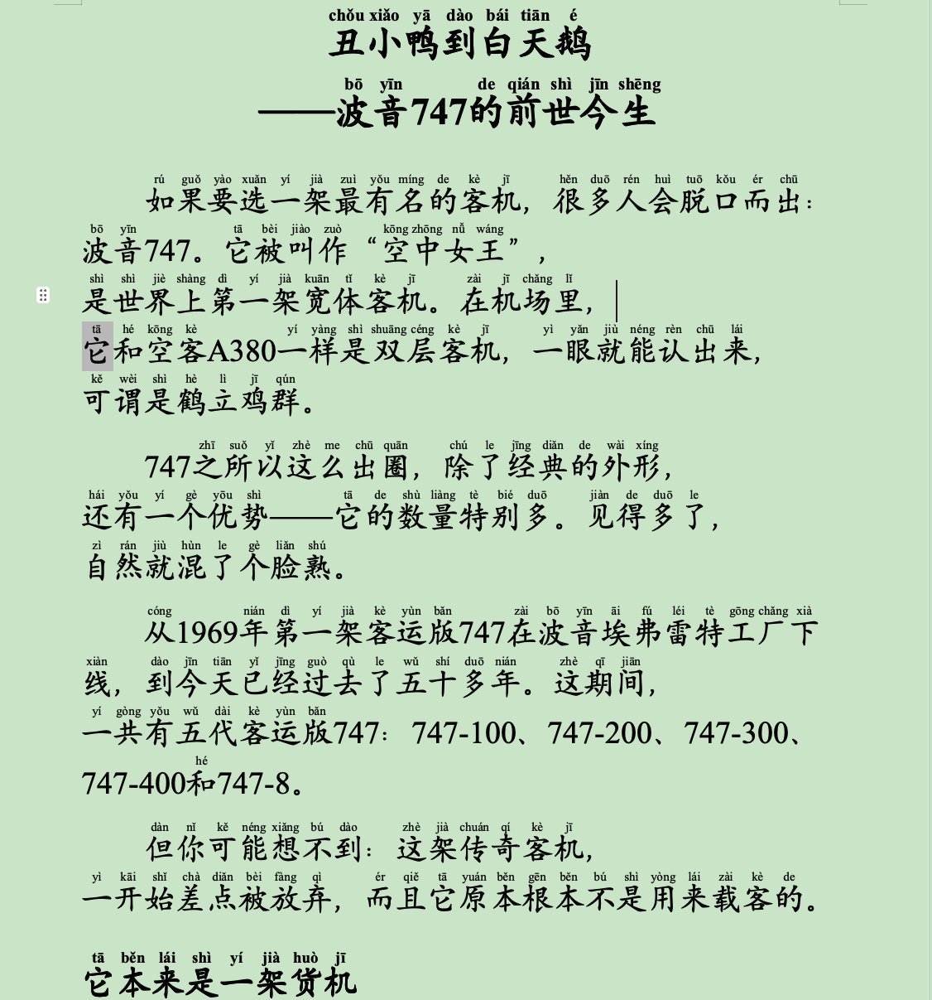

# Retake Reading · 好奇爸爸

> 如果你家孩子也不爱读书，但特别爱看 B 站——
> 那我们换个法子：**先让他读，再让他看。**

---

## 先看看它做出来是什么样



上面这张，是我给儿子做的第三份。他喜欢飞机，我挑了波音 747 那期视频。

打印出来是 A4，每个汉字正上方有拼音，字很大，一页没多少内容，孩子读起来不费劲。读完这一篇，才准看那一集视频。

他读到「空中女王」的时候停下来问我：「它真的能装下整个航天飞机？」——那一瞬间我就知道，这事做对了。

---

## 为什么叫「邪修」

正经的修法，是坐下来读经典、读名著、读老师推荐的书。

这条路我走过。走不通。孩子反感，你越推他越远。

邪修是另一条：**不跟他的逆反正面硬碰，绕到他最爱的地方，从侧面切进去。**

他爱看 B 站，那就把他爱看的内容变成文字。不是逼他读书，是让阅读变成他拿到喜欢的东西的一道门。

「邪」不是坏，是**偏门**。用偏门的路子，办正经的事。

**为什么叫「重建」，不叫「培养」**

「培养」是从无到有，是学校的说法，默认孩子肚子里什么都没有。

「重建」承认另一件事：这个习惯本来有，只是后来塌了。小学低年级的孩子大多能捧着书看半天，是被读题、被要求、被比较，一点一点磨没的。

所以我们不是在从零教他读书，是在把它重新盖起来。

这个区别很重要——**它不指责孩子懒，也不指责你没做好，只说明一个事实：塌了，那就重新盖。**

英文名用 **Retake** 也是这个意思：`retake` 是「重修、补考」，默认这门课上过、没通过、现在再来一遍。

---

## 这个 Skill 从哪一步开始

**从你手里有一份字幕文件开始。**

```
你做完的：找到视频 → 拿到 SRT / TXT 字幕
              ↓
这个 Skill：把字幕 → 变成带拼音的打印稿
```

**怎么拿字幕？** 很简单，不用装任何软件：

1. 复制视频链接
2. 粘贴到任意字幕提取网站（浏览器搜「B站 字幕 提取」）
3. 下载 SRT 文件

这一步我放在视频里演示，你跟着点几下就完成了。

**为什么不把它做进 Skill？** 因为它要靠平台登录、第三方工具，网站一改版就坏。而人工点几下，几秒钟就完事。

**把简单的事交给人，把重复的事交给代码。** 这样它才不容易坏。

---

## 它具体会做什么

| 步骤      | 它会做什么                        |
| ------- | ---------------------------- |
| 1. 洗字幕  | 把字幕里那些时间轴、序号去掉，变成干净的文字       |
| 2. 理文章  | 分段、加小标题、补标点、修错别字、统一人名地名      |
| 3. 加拼音  | 每个字正上方标拼音，多音字逐个核对            |
| 4. 排版   | 楷体、20 磅大字、单倍行距、每页有页码，A4 直接打印 |
| 5. 请你检查 | 列出一份「可能读错的字」，你听一下对不对         |

**第 2 步有一条铁律：内容一律保留，不压缩。**

原稿里的故事、数字、原理，甚至说话人的口气，都是内容。你觉得啰嗦的地方，孩子可能正好爱看。

唯一可以动的是开头那些完全没画面感的梗（比如「柯南里是波音 747」）——这类会先告诉你，由你决定删不删。

---

## 最省事的用法（不用装任何东西）

1. 打开 [`quick-start.md`](quick-start.md)
2. 把中间那段话整段复制
3. 发给你的 AI，再把字幕文件一起传上去

它会给你一份 Word，下载打印就完事。

**先问它一句**：「你能读文件、能生成可下载的 docx 吗？」做不到就换一个。

---

## 装成技能（以后随时调用）

1. 点右上角绿色 **Code** → **Download ZIP**
2. 解压，把 `skills/retake-reading` 整个文件夹放进：

```
~/.workbuddy/skills/     （WorkBuddy）
~/.claude/skills/        （Claude Code）
你的工作区/skills/        （Proma）
```

3. 装两个 Python 小库：

```bash
python3 -m pip install pypinyin python-docx
```

4. 重启你的 AI 工具

装好后直接说：「帮我给这个字幕做一份带拼音的阅读稿」。

---

## 在 Mac 和 Windows 上都能用吗

**都能用。** 但我只在 Mac 上实测过，下面是实情：

|         | Mac          | Windows               |
| ------- | ------------ | --------------------- |
| 生成 Word | ✅ 实测通过       | ⚠️ 理论上可以，我没机器测        |
| 文件名解压   | ✅ 已修（全英文文件名） | ✅ 英文名不会出问题            |
| 中文字幕读取  | ✅ 实测通过       | ✅ 读文件时显式指定了编码         |
| 控制台输出   | ✅ 实测通过       | ✅ 已加 UTF-8 保护，不会因编码崩溃 |
| 楷体显示    | 用替代字体        | ✅ Windows 自带楷体，更省事    |

**Windows 用户请注意两件事：**

1. **装 Python**：去 python.org 下载，安装时**务必勾选「Add Python to PATH」**。不勾的话命令行找不到 python。
2. **不要用记事本改 `phrases.json`**：用 VS Code 或者直接让 AI 改，记事本可能把编码存坏。

如果你在 Windows 上遇到问题，来 Issues 说一声，我照着改。

---

## 几个容易踩的坑

**打开看不到拼音？**
用 **WPS 或 Word** 打开。Mac 按空格键的那种预览不显示拼音层，别以为生成失败了。

**拼音被拉得很开，或者挤成一团？**
Word 拼音指南默认会按汉字宽度拉伸拼音。需要设成「居中」，脚本已经处理好了。

**楷体显示不出来？**
Mac 没装楷体。脚本已经做了替代（WPS 里的「汉仪楷体简」、Mac 版 Word 里的「STKaiti」），打开就能看到。

**WPS 另存之后文件变大？**
正常。WPS 会把拼音换个方式存，显示不受影响。

---

## 一条规矩

**别把这件事做成新的作业。**

读完就是读完。不用写读后感，不用回答问题，不用复述。

唯一的规则：**读完这一篇，才能解锁这一集视频。**

孩子认这套，是因为它在交换，不是在管教。

---

## 目录结构

```
.
├── preview.png                     ← 上面那张成品效果图
├── README.md                       ← 你正在看的
├── quick-start.md        ← 不想安装就用这个
├── LICENSE (MIT)
└── skills/
    └── retake-reading/             ← 技能本体
        ├── SKILL.md                ← 给 AI 看的说明书
        ├── scripts/
        │   ├── clean_subtitle.py   ← 洗字幕
        │   └── build_pinyin_docx.py← 生成带拼音 Word
        └── assets/
            ├── phrases.json      ← 104 条多音字纠正
            └── example.json
```

---

## 这东西是怎么做出来的

我是个普通爸爸，不是程序员。这是我这辈子第一次往 GitHub 上传东西。

为了不把半成品交出去，我把做好的东西反复送去「挑刺」：

|           |                                    |
| --------- | ---------------------------------- |
| 用了几个模型    | **4 个**（一个负责写，两个负责挑错，各有所长）         |
| 交叉验证      | **3 轮**（每轮挑完我就改，改完再挑）              |
| 消耗的 token | **约 1,042 万**（输入 936 万 + 输出 105 万） |
| 被挑出的真问题   | **20 多个**                          |

第一轮挑出来的问题，让我有点脸红：

**「儿子」这两个字，拼音标错了。**

标成了 `r zi`——把「儿」当成了儿化音。可「儿子」的「儿」明明读 ér。

同样错的还有「儿童」「婴儿」「女儿」。这些都是儿童读物里最常见的词。也就是说，我之前给儿子做的那三份稿子，最基础的字就是错的。

第二轮更狠。我修了一版，以为好了，结果被告知：只修了一半。「卖点儿钱」的「点儿」又错了；「一百」「一年」「不一样」里的「一」全错。

**最要命的一条**：我做的那个「让家长检查拼音」的功能，实际上一条错都检查不出来。

第三轮找到了根子上的问题：**就算家长把正确读音告诉我，程序也不会改。** 它会先用我给的词表，然后又被自己的自动规则覆盖一遍——等于我说了不算。

这些我都一个一个修了。

改完之后，44 个最容易错的字和词，全部标对了。

---

说这些不是想证明什么。

只是想说：**一个爸爸想给孩子做点东西，是愿意把它磨到能拿出手为止的。**

如果你用的时候发现哪里不对，欢迎告诉我。我知道那种「明明很努力但还是有错」的感觉。

## 写在最后

我做这个，不是为了教别人怎么带孩子。

就是有一天，我看着儿子捧着手机刷视频，突然想：**他愿意花四十分钟看一集空难解说，为什么不愿意读四十分钟的书？**

后来我想明白了——不是他不爱读，是他没得选。大人给的书，跟他想看的东西，是两回事。

所以我把顺序换了一下。

现在他自己会问：「今天有新的吗？」

如果你也想试试，这个仓库里的东西都可以拿去用。有问题，在 Issues 里说一声。

**愿每个孩子，都能找到自己想读的那一篇。**

---

## License

MIT —— 随便用、随便改、随便传，保留署名就行。
